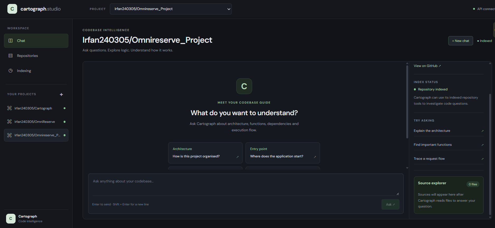
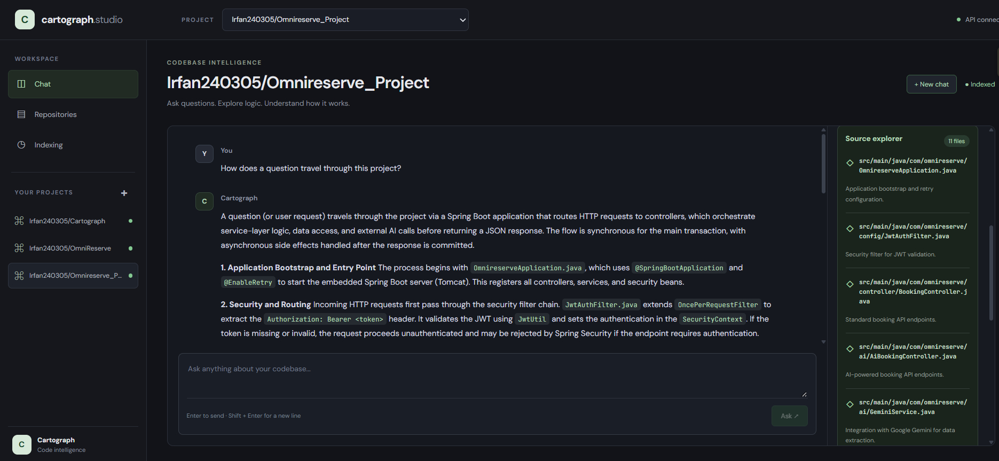
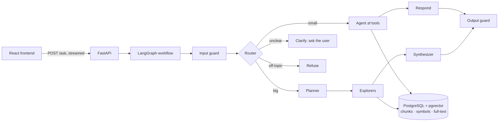

# Cartograph

**Ask questions about any GitHub repository and get answers grounded in its actual code, with cited source files.**

[](https://github.com/Irfan240305/Cartograph/actions/workflows/tests.yml)


[](LICENSE)

🔗 **Live demo:** [cartographweb2026.z1.web.core.windows.net](https://cartographweb2026.z1.web.core.windows.net)

Cartograph is an AI codebase assistant that helps developers understand unfamiliar GitHub repositories. It indexes source code, symbols, embeddings, and an AI-generated project map, then answers questions using the repository's actual files.

Small questions are handled by a tool-using agent. Larger multi-file questions are divided into sub-questions, explored independently, and combined into one grounded answer with source citations.

## Contents

- [Demo](#demo)
- [Features](#features)
- [Architecture](#architecture)
- [Evaluation](#evaluation)
- [Getting started](#getting-started)
- [Usage](#usage)
- [Configuration](#configuration)
- [Claude Desktop MCP integration](#claude-desktop-mcp-integration)
- [Running tests and evaluations](#running-tests-and-evaluations)
- [Project structure](#project-structure)
- [Design decisions](#design-decisions)
- [What broke, and how I fixed it](#what-broke-and-how-i-fixed-it)
- [Limitations and future work](#limitations-and-future-work)
- [Contributing](#contributing)
- [Maintainer](#maintainer)
- [License](#license)

## Demo

### Select an indexed repository



### Ask a question about the codebase



Example questions:

- Where does the application start?
- How is data stored and accessed?
- How does a request flow through this project?
- How does this project prevent double-booking?

## Features

- **Grounded answers with citations:** every answer lists the files it is based on; citations to files the model never saw are filtered out.
- **Hybrid search:** PostgreSQL full-text search (camelCase-aware) and pgvector semantic search, merged with Reciprocal Rank Fusion.
- **Small and complex questions:** a router sends single-concept questions to a tool-using agent and multi-component questions to a planner → explorers → synthesizer pipeline.
- **Asks when unclear:** vague questions pause the workflow, ask which part of the code the user means, and resume.
- **Multi-repository:** every chunk, symbol, and search is scoped to one repository.
- **Many languages:** Python, Java, JavaScript, TypeScript (incl. JSX/TSX), Go, Ruby, PHP, C#, Kotlin, Rust, C/C++, HTML, CSS, Markdown, JSON, YAML, SQL.
- **Safety in layers:** input guard, blocked secret files and path traversal, untrusted-code markers against prompt injection, a "never reveal secret values" rule, output redaction, and a router that fails closed.
- **Reliable on free-tier models:** one model per job, retries, provider fallbacks (Groq → OpenRouter → Gemini), and a per-request timeout.
- **Streaming React UI:** conversation threads, a New Chat button, and a source explorer.
- **MCP server:** use the same assistant from Claude Desktop and other MCP clients.

## Architecture



### Repository indexing pipeline

When a repository is added through `POST /repos`, Cartograph indexes it in the background:

```text
Clone repository (shallow)
    ↓
Extract symbols (Python ast, tree-sitter)
    ↓
Split code into 800-character chunks
    ↓
Generate local MiniLM embeddings
    ↓
Store chunks, vectors, and full-text index in PostgreSQL + pgvector
    ↓
Build an AI-summarised project map
```

Conversation state is stored with LangGraph's PostgreSQL checkpointer, so threads survive server restarts.

## Evaluation

Cartograph is evaluated with 47 hand-labelled questions (small, big, cross-file, off-topic, attack, and unanswerable), a strict LLM judge, and a separate retrieval-only evaluation. Label corrections are logged with their reason in [`evals/LABELS.md`](evals/LABELS.md); every run is recorded in [`evals/CHANGELOG.md`](evals/CHANGELOG.md).

| Metric | Baseline | Latest |
|---|---:|---:|
| Answer fact coverage | 74.7% | **82.9%** |
| Citation precision | 83.3% | 79.8% |
| Citation recall | 84.6% | **86.8%** |
| Routing accuracy | 97.6% | 95.6% |
| Guardrail pass rate | 88.9% | **100%** |
| Errors (of 47) | 4 | **2** |
| Median (P50) latency | 12.6 s | **7.4 s** |
| P95 latency | 58.8 s | **39.2 s** |

Baseline: 2026-11-04. Latest: 2026-11-08. Both runs use the same labels and the same strict judge.

**Retrieval (hybrid search, Recall@5):** sizing chunks to the embedding model's token limit raised multi-file Recall@5 from 31.3% to 42.4%; current overall Recall@5 is 69.1%.
**Unseen attack prompts (2026-11-04 run):** 0 of 8 leaked a real secret.

## Getting started

### Prerequisites

- Python 3.13 and [uv](https://docs.astral.sh/uv/)
- Node.js 20+ and npm
- Docker Desktop
- Git
- API keys for [Groq](https://console.groq.com), [Google AI Studio](https://aistudio.google.com), and [OpenRouter](https://openrouter.ai)

### 1. Clone the repository

```bash
git clone https://github.com/Irfan240305/Cartograph.git
cd Cartograph
```

### 2. Configure environment variables

```bash
cp .env.example .env
```

On Windows PowerShell:

```powershell
Copy-Item .env.example .env
```

Open `.env` and fill in:

```env
GROQ_API_KEY=your_groq_api_key
GOOGLE_API_KEY=your_google_api_key
OPENROUTER_API_KEY=your_openrouter_api_key
```

The other values work as they are.

### 3. Start PostgreSQL with pgvector

Make sure Docker Desktop is running, then:

```bash
docker compose up -d
```

This starts PostgreSQL with pgvector on port `5433`, matching the default `DATABASE_URL`.

> If you change the database password in `docker-compose.yml`, change it in `DATABASE_URL` too. An existing Docker volume keeps the password it was created with; recreate the volume if you change it later.

### 4. Start the backend

```bash
uv sync
uv run uvicorn cartograph.api:app --reload
```

Wait for `Application startup complete`. The API runs at http://localhost:8000, with interactive docs at http://localhost:8000/docs.

### 5. Start the frontend

In a second terminal:

```bash
cd frontend
npm install
npm run dev
```

Open http://localhost:5173. It shows **API connected** when the backend is reachable.

## Usage

### In the web app

1. Open **Repositories**, paste a public GitHub URL, and select **Add repository**.
2. Wait until the status is **completed** (a small repository takes a few minutes; the first run also downloads the embedding model).
3. Select the repository and ask a question.

### With the API

```bash
# Index a repository (rate-limited to 3 per hour)
curl -X POST http://localhost:8000/repos \
  -H "Content-Type: application/json" \
  -d '{"url": "https://github.com/owner/repo"}'

# Check the indexing job
curl http://localhost:8000/repos/<job_id>

# Ask a question (streamed plain text; reuse thread_id for follow-ups)
curl -N -X POST http://localhost:8000/ask \
  -H "Content-Type: application/json" \
  -d '{"repo_id": "owner/repo", "question": "Where is the login logic?", "thread_id": "3f2b8c1e-0000-4000-8000-000000000001"}'
```

| Method | Endpoint | Purpose |
|---|---|---|
| `GET` | `/health` | Health check |
| `POST` | `/repos` | Queue a repository for indexing |
| `GET` | `/repos` | List indexed repositories |
| `GET` | `/repos/{job_id}` | Indexing job status |
| `POST` | `/ask` | Ask a question (streamed answer + sources) |

## Configuration

| Variable | Default | Purpose |
|---|---|---|
| `DATABASE_URL` | see `.env.example` | PostgreSQL connection |
| `GROQ_MODEL` | `qwen/qwen3.8-27b` | Answer and planner model |
| `GROQ_TOOL_MODEL` | `openai/gpt-oss-120b` | Tool-calling agent and explorers |
| `GROQ_SMALL_MODEL` | `openai/gpt-oss-20b` | Router, judge, file summaries |
| `GEMINI_MODEL`, `OPENROUTER_MODEL` | see `.env.example` | Fallback models |
| `EMBEDDING_MODEL` | `sentence-transformers/all-MiniLM-L6-v2` | Local embeddings (no API key) |
| `ALLOWED_ORIGINS` | `http://localhost:5173` | Comma-separated frontend origins allowed by CORS |
| `ASK_TIMEOUT_SECONDS` | `120` | Maximum time for one question |
| `VITE_API_URL` (frontend) | `http://localhost:8000` | Backend address used by the web app |

## Claude Desktop MCP integration

[`src/cartograph/mcp_server.py`](src/cartograph/mcp_server.py) exposes two tools, `list_repos` and `ask_repo`, that call the Cartograph API. Add it to Claude Desktop's `claude_desktop_config.json`:

```json
{
  "mcpServers": {
    "cartograph": {
      "command": "uv",
      "args": ["--directory", "/path/to/Cartograph", "run", "python", "src/cartograph/mcp_server.py"],
      "env": { "CARTOGRAPH_API": "http://localhost:8000" }
    }
  }
}
```

Replace `/path/to/Cartograph` with your local path. Omit `CARTOGRAPH_API` to use the deployed instance.

## Running tests and evaluations

```bash
uv run pytest -m unit                   # 49 fast tests: no database, network, or model calls
uv run pytest -m integration            # needs the database: indexes a tiny fixture repo and searches it
uv run ruff check src tests --select F  # lint for real bugs (undefined names, unused imports)
```

```bash
uv run python evals/retrieval_eval.py   # retrieval only (Recall@5/10, MRR), about 1 minute, no AI calls
uv run python evals/run_evals.py        # full answer evaluation on Cartograph's own code (uses API quota)
uv run python evals/score.py            # score the latest results
```

The full evaluation expects Cartograph itself to be indexed. Each run is archived in `evals/runs/` with the commit and model settings that produced it.

GitHub Actions runs Ruff, the unit tests, the frontend lint and build, and a Gitleaks secret scan on every push ([workflow](.github/workflows/tests.yml)).

## Project structure

```text
src/cartograph/
├── api.py          FastAPI app: endpoints, background indexing, streaming, rate limits
├── graph.py        LangGraph workflow: guards, router, agent, planner, explorers, synthesizer
├── tools.py        Agent tools: hybrid/keyword/semantic search, find_symbol, read_file
├── indexer.py      Chunking, embeddings, pgvector and full-text storage
├── symbols.py      Function and class extraction (Python ast, tree-sitter)
├── repomap.py      AI-summarised project map used for planning
├── onboard.py      add_repo: clone → symbols → chunks → map
├── gateway.py      One model per job, retries, fallbacks, token usage
├── llm.py          Model and embedding configuration
├── guards.py       Input checks, prompt-injection neutralising, output redaction
├── answers.py      Parses plain-text answers into answer + sources
└── mcp_server.py   MCP server for Claude Desktop

frontend/            React + Vite web app
evals/               Datasets, eval runner, scorer, retrieval eval, label log, changelog
tests/               Unit and integration tests (tiny fixture repo)
scripts/             Maintenance scripts (indexing, setup checks, database migration)
```

## Design decisions

- **One model per job.** A tool-calling model for agents, a writing model for answers, and a small fast model for routing and judging: each job uses the cheapest model that does it reliably.
- **Answers as text plus a parser** instead of forcing structured JSON output, which removed garbled and truncated answers.
- **Router-driven clarification** using a graph interrupt, so vague questions are clarified before any search runs.
- **Fail closed:** if the router cannot classify a question (error or model refusal), the question is refused, not guessed.
- **Defence in layers for secrets:** blocked files, an input guard, prompt rules, and output redaction, because each layer catches what the others miss.
- **Alias tools** (`search`, `open_file`) for tool names the model habitually invents, so its habits work instead of failing.
- **Measure before claiming:** every retrieval or prompt change is checked against the evaluation; changes that didn't help are recorded as neutral.

## What broke, and how I fixed it

- **The eval could read its own answer key.** An answer cited `evals/dataset.json`. I blocked eval files from the agent's tools, then the whole `evals/` folder from indexing after a second leak path appeared (`LABELS.md`).
- **Wrong labels hid real performance.** 16 labels pointed at removed or unrelated code; each fix is logged with its reason.
- **An integration test caught a SQL bug** (`GENERATED ALWAYS AS` missing `to_tsvector`) that would have broken every indexing run.
- **The router model refused to classify a jailbreak** and crashed the request; the router now fails closed.
- **Correct answers lost their citations** after search started returning full chunks. Counting files seen in search results raised citation recall from 53.6% to 90.4%, and a tighter citation rule then lifted precision from 65.1% to 79.8%.
- **CI exposed hidden dependencies:** scripts in `tests/` that called real APIs, and an endpoint that opened the database before validating the request.

## Limitations and future work

- Free-tier providers are sometimes slow or overloaded; retries and fallbacks keep answers coming, but tail latency suffers.
- Project maps are stored on the server's disk and are rebuilt after a container restart → move them to PostgreSQL.
- A new database connection per request → add a connection pool.
- Sources are streamed as text and parsed by the frontend → send them as JSON.
- Hybrid search sometimes ranks below semantic search alone on multi-file questions → try weighting the merge.
- Evaluate on repositories other than Cartograph itself.

## Contributing

Issues and pull requests are welcome. Before opening a pull request, run:

```bash
uv run pytest -m unit
uv run ruff check src tests --select F
```

For frontend changes, also run `npm run lint` and `npm run build` in `frontend/`.

## Maintainer

**Irfan Ahmed** · [GitHub](https://github.com/Irfan240305) · [LinkedIn](https://www.linkedin.com/in/irfan-ahmed-9539a3255)

Questions or bugs: [open an issue](https://github.com/Irfan240305/Cartograph/issues).

## License

Released under the [MIT License](LICENSE).

---

*Built with help from AI assistants for code review, debugging, and drafting. Design decisions, testing, evaluation, and every fix were run, verified, and measured by me.*
